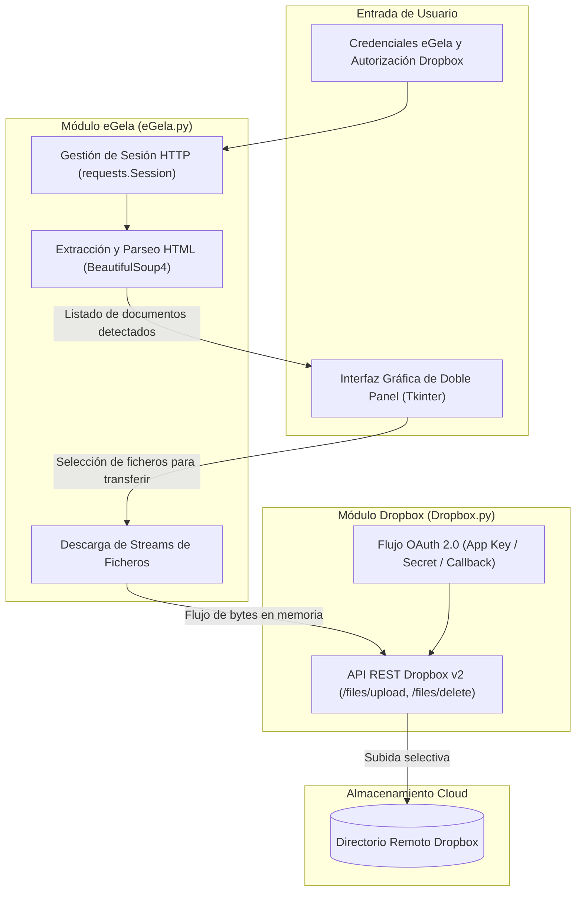

# eGela2Dropbox - Cliente de Automatización y Sincronización Cloud

<p align="left">
  
  
  
  
  
</p>

Aplicación de escritorio con interfaz gráfica que automatiza el acceso, extracción y sincronización selectiva de documentos docentes alojados en la plataforma eGela (Moodle de la Universidad del País Vasco) hacia el servicio de almacenamiento en la nube Dropbox mediante su API oficial con autenticación OAuth 2.0.

Desarrollado para la asignatura Sistemas Web en el Grado en Ingeniería Informática.

---

## Índice
- [Descripción general](#descripción-general)
- [Arquitectura y flujo de integración](#arquitectura-y-flujo-de-integración)
- [Características técnicas](#características-técnicas)
- [Estructura del proyecto](#estructura-del-proyecto)
- [Instalación y puesta en marcha](#instalación-y-puesta-en-marcha)
- [Equipo](#equipo)
- [Contexto académico](#contexto-académico)

---

## Descripción general

La herramienta soluciona la gestión y respaldo manual de materiales académicos mediante un cliente de doble panel:
1. Conecta con el campus virtual eGela, gestiona la sesión web del alumno y analiza el árbol HTML de la asignatura para listar todos los recursos PDF disponibles.
2. Autoriza el acceso a la cuenta del usuario en Dropbox a través de OAuth 2.0.
3. Permite al usuario transferir selectivamente los ficheros seleccionados directamente al directorio remoto deseado, gestionar carpetas remotas o descargarlos a local.

---

## Arquitectura y flujo de integración



---

## Características técnicas

- **Gestión de Sesiones y Web Scraping:** Uso de `requests.Session` para mantener cookies de autenticación en Moodle y `BeautifulSoup4` para filtrar selectivamente los enlaces de descarga de recursos PDF.
- **Integración con Dropbox API v2:** Implementación del flujo de autorización por código OAuth 2.0 con apertura automática del navegador (`webbrowser`) y gestión segura de tokens de acceso para operaciones de subida, borrado y creación de carpetas.
- **Transferencia directa en memoria:** Los ficheros se descargan desde eGela y se transmiten por streaming hacia la API de Dropbox sin necesidad de generar archivos temporales en el disco del usuario.
- **Interfaz Gráfica (Tkinter):**
  - Panel izquierdo: materiales disponibles en el aula virtual de eGela con selección múltiple.
  - Panel derecho: explorador de ficheros del directorio Dropbox en tiempo real.
  - Barras de progreso modales (`helper.py`) para monitorizar transferencias en bloque.
  - Funciones auxiliares: creación y borrado de carpetas remotas, consulta de cuota de almacenamiento disponible (`Account Info`) y descarga directa a disco local.

---

## Estructura del proyecto

```text
SistemasWeb/
├── actividad_4.py              # Controlador principal y construcción de la GUI (Tkinter)
├── eGela.py                    # Cliente HTTP, login en Moodle y scraping con BeautifulSoup
├── Dropbox.py                  # Cliente de la API de Dropbox, OAuth 2.0 y llamadas REST
├── helper.py                   # Utilidades auxiliares (ventanas de progreso y cuadros de diálogo)
├── requirements.txt            # Dependencias externas del entorno
└── README.md
```

---

## Instalación y puesta en marcha

### Requisitos previos
- Python 3.10 o superior (Tkinter viene incluido con la instalación estándar de Python).

### 1. Clonar el repositorio
```bash
git clone https://github.com/28ivan/web-systems-project.git
cd web-systems-project
```

### 2. Configurar entorno virtual (recomendado)
En Windows (PowerShell):
```powershell
python -m venv venv
.\venv\Scripts\Activate.ps1
```

En Linux / macOS:
```bash
python3 -m venv venv
source venv/bin/activate
```

### 3. Instalar dependencias
```bash
pip install -r requirements.txt
```

### 4. Ejecutar la aplicación
```bash
python actividad_4.py
```
Al iniciar, la aplicación solicitará las credenciales de eGela para listar los documentos y abrirá el navegador para completar la vinculación OAuth con la cuenta de Dropbox de destino.

---

## Equipo

Proyecto desarrollado de forma colaborativa por:
- **[Iván Herrera Álvarez](https://github.com/28ivan)**
- Daniel Talmaci
- June Castro
- Iker Fernández

---

## Contexto académico

Proyecto desarrollado para la asignatura de **Sistemas Web** dentro del **Grado en Ingeniería Informática de Gestión y Sistemas de Información** en la **Universidad del País Vasco (UPV/EHU)**.
